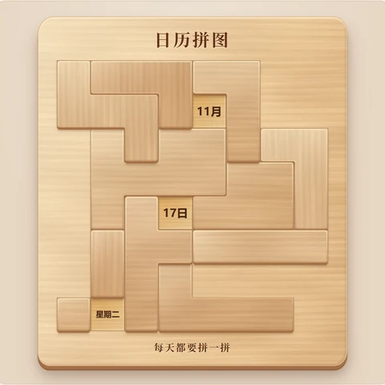

# 日历拼图（Calendar Puzzle）

一款木质多联骨牌日历拼图游戏。移动、旋转和翻转木质拼块，在棋盘上只露出目标月份、日期与星期，全年每一天都有解。核心求解与校验引擎由 Rust/WASM 驱动。



## 说明

详细规则与数据校验见 [docs/calendar-puzzle.md](docs/calendar-puzzle.md)。

## 本地运行

安装 Bun 1.4.2、Node.js 22.12+、Rustup（按 `rust-toolchain.toml` 自动配置）以及 `wasm-pack 0.15.1`。

```sh
cargo install wasm-pack --version 0.15.1 --locked
bun install
bun run dev
```

| 命令 | 说明 |
| --- | --- |
| `bun run build:wasm` | 使用 `wasm-pack` 编译 Rust 拼图引擎 |
| `bun run dev` | 构建 WASM 并启动 Vite 开发服务器 |
| `bun run test` | 运行前端会话测试与 Rust 引擎测试 |
| `bun run verify:calendar` | 校验全年所有日期组合的可解性 |
| `bun run typecheck` | TypeScript 类型检查 |
| `bun run lint` | ESLint 代码检查 |
| `bun run build` | 构建 WASM、类型检查并输出 `dist/` |
| `bun run preview` | 预览生产构建 |
| `bun run test:browser` | 运行 Playwright 浏览器端测试 |
